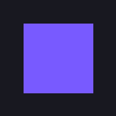
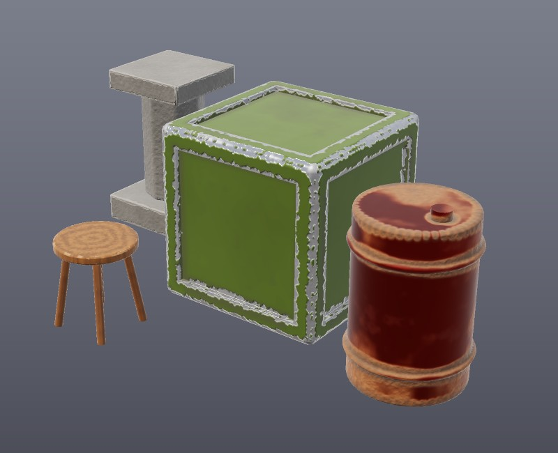
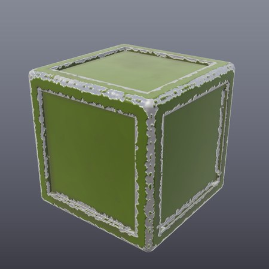
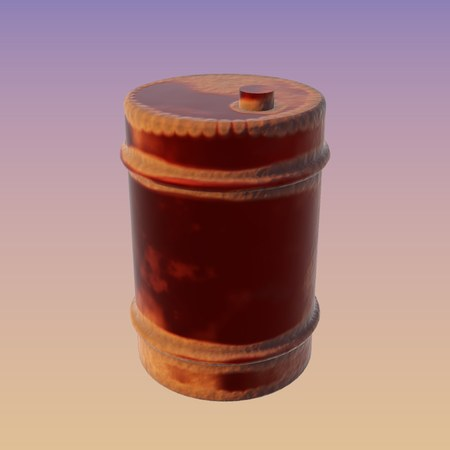
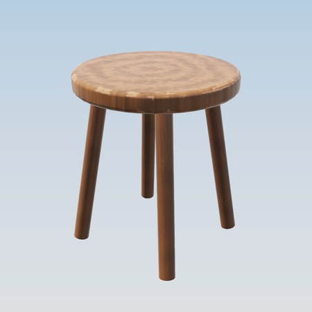
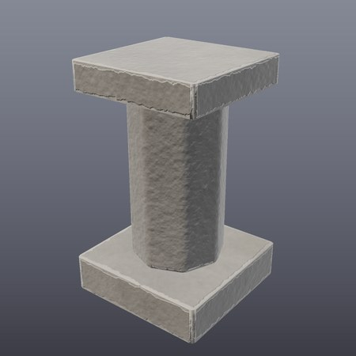
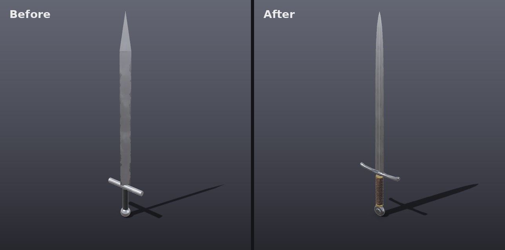
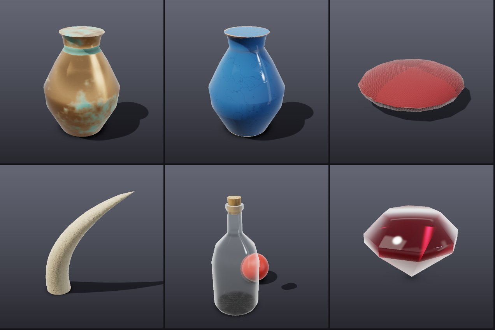

<div align="center">



# MeshMind

**3D modelling for the AI era.** Describe the model you want; your AI agent builds it.

[](https://github.com/aldotoa/meshmind/actions/workflows/ci.yml)
[](LICENSE)



</div>

MeshMind is an open-source modelling app that AI agents drive through
[MCP](https://modelcontextprotocol.io). You get game-ready assets without
learning a complex 3D tool, and without paying for another AI service.

- **Your agent does the clicking.** Every feature is a tool an AI can call,
  with a built-in guide that teaches it a professional workflow.
- **Use the AI subscription you already have.** Works with Claude Code, Codex,
  Cursor, VS Code, Gemini CLI or any MCP client. MeshMind never calls an AI API.
- **Game-ready output.** Bevelled edges, watertight booleans, and smart
  materials baked into PBR textures, exported as glTF that opens cleanly in
  Unity, Unreal, Godot and Blender.
- **Windows, macOS and Linux.**

## Get started

1. **Install** the desktop app from the
   [latest release](https://github.com/aldotoa/meshmind/releases/latest)
   (or [build from source](#build-from-source)).
2. **Connect your agent** once. In Claude Code:

   ```sh
   claude mcp add --transport http meshmind http://127.0.0.1:7878/mcp
   ```

   Other agents: see [docs/AGENTS.md](docs/AGENTS.md).
3. **Ask for a model**, and watch it appear in the window:

   > Using MeshMind, build a sci-fi supply crate with bevelled edges, recessed
   > side panels and worn olive paint, then export it to crate.glb.

More prompts that work well are in [docs/EXAMPLES.md](docs/EXAMPLES.md), and
[docs/RECIPES.md](docs/RECIPES.md) walks through how a longsword, an axe, a
barrel and a potion bottle are built, tool call by tool call.

## What agents can do

| | Tools |
|---|---|
| Create | `loft` (blades, handles, horns), `lathe` (round parts), `extrude_outline` (flat silhouettes), `sweep` (tubes, rope, grip wraps), `create_primitive` |
| Shape | `deform` (bend, twist, taper), `move_vertices`, `slice`, `extrude`, `inset`, `bevel`, `subdivide`, `boolean` (union, difference, intersection), `mirror`, `array`, `set_shading` |
| Scene | `list_objects`, `get_object`, `set_transform`, `duplicate_object`, `delete_object`, `clear_scene`, `undo`, `redo` |
| Look | `apply_smart_material` (painted, bare, rusty and polished metal, gold, bronze, glass, gemstone, ceramic, fabric, leather, bone, plastic, wood, stone, rubber), `set_material`, `unwrap_uvs`, `set_lighting` |
| Review | `render_preview` returns studio-lit images (with close-ups via `focus`) the agent looks at to check its own work |
| Files | `export_glb` (glTF 2.0 with textures), `save_project` and `open_project` (`.meshmind`) |

Smart materials are baked from the shape: paint chips off convex edges, grime
and rust collect in creases, dust settles on top, and fine detail goes into a
normal map. Full reference: [docs/TOOLS.md](docs/TOOLS.md).

| | | | |
|---|---|---|---|
|  |  |  |  |





Every image above was made with tool calls only, by
[scripts/render_gallery.py](scripts/render_gallery.py) and
[scripts/recipes.py](scripts/recipes.py).

## Headless mode

Without the desktop app, agents can run MeshMind themselves:

```sh
claude mcp add meshmind -- meshmind-mcp     # stdio
meshmind-mcp --http 7878                    # or HTTP
```

`meshmind-mcp` binaries are attached to each release. The agent still sees its
work through `render_preview`.

## Build from source

Requires Rust, CMake and a C++ compiler (for the Manifold boolean library),
plus the [Tauri prerequisites](https://v2.tauri.app/start/prerequisites/) for
the desktop app.

```sh
cargo run --release -p meshmind-desktop          # desktop app
cargo install --path crates/meshmind-mcp         # headless server
```

## Project layout

| Path | What it is |
|---|---|
| `crates/meshmind-core` | Engine: scene, polygon meshes, modelling ops, Manifold booleans, UV unwrapping, smart material baking, glTF export, project files |
| `crates/meshmind-mcp` | MCP server exposing the engine as agent tools (stdio and HTTP) |
| `crates/meshmind-render` | CPU preview renderer used by `render_preview` |
| `apps/desktop` | Tauri desktop app: live viewer, autosave |
| `docs/` | [Agents](docs/AGENTS.md), [examples](docs/EXAMPLES.md), [recipes](docs/RECIPES.md), [tools](docs/TOOLS.md), [architecture](docs/ARCHITECTURE.md), [releasing](docs/RELEASING.md) |

## Contributing

Contributions are welcome: see [CONTRIBUTING.md](CONTRIBUTING.md). Please
report security issues privately as described in [SECURITY.md](SECURITY.md).

## License

MIT. See [LICENSE](LICENSE). The desktop app bundles
[three.js](https://threejs.org) (MIT); booleans use
[Manifold](https://github.com/elalish/manifold) (Apache-2.0).
