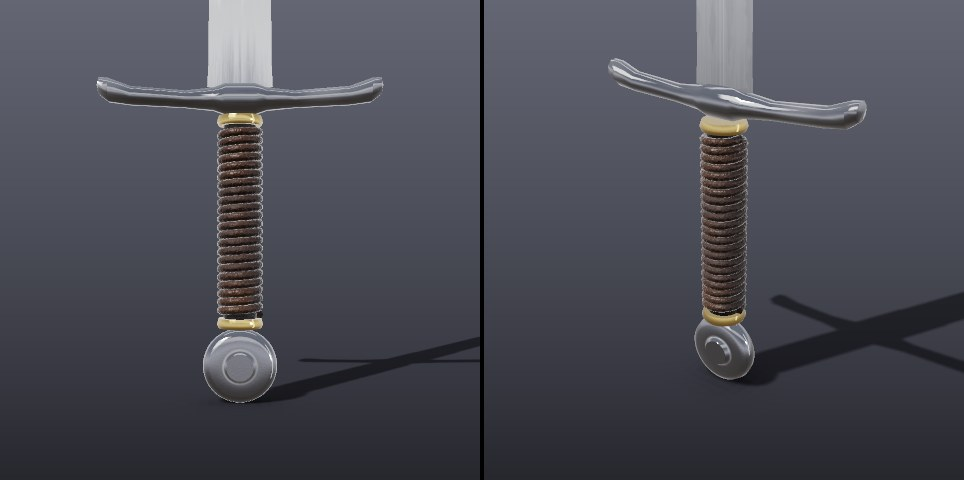
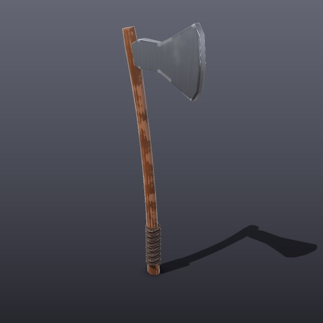
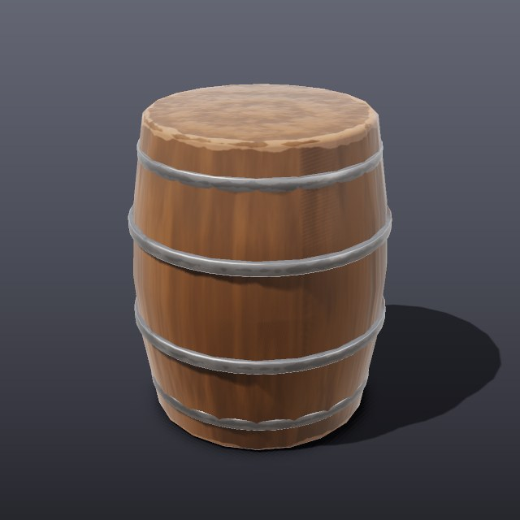
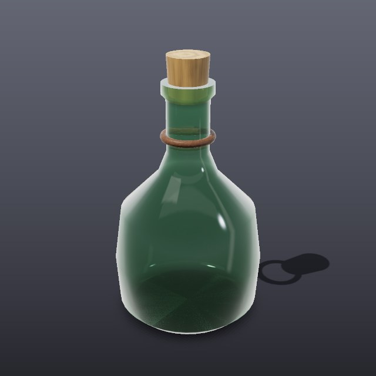

# Modelling recipes

Worked examples of how to build convincing game props with MeshMind's tools.
Each one is a real script, [`scripts/recipes.py`](../scripts/recipes.py), that
drives `meshmind-mcp` with ordinary tool calls, so an agent can follow the
same steps. Run them yourself:

```sh
cargo build --release -p meshmind-mcp
python3 scripts/recipes.py out            # all of them
python3 scripts/recipes.py out sword      # just one
```

## The rule that matters most

**Pick the shape tool by the part's silhouette.** Boxes and plain cylinders
read as placeholders. Almost every real object is made of parts that are
lofted, lathed, extruded from an outline or swept along a path:

| Part looks like | Tool | Examples |
|---|---|---|
| Changes cross-section along its length | `loft` | blades, handles, horns, legs, spires, fins |
| Round, like it was turned on a lathe | `lathe` | pommels, knobs, bottles, barrels, wheels, columns |
| A flat silhouette with thickness | `extrude_outline` | axe heads, shields, brackets, gears, signs |
| A tube along a path | `sweep` | rope, cables, pipes, rings, grip wraps (`helix`) |
| Curved, twisted or tapered | `deform` | curved blades, twisted bars, bent handles |

Then: small separate parts (rings, ferrules, straps, rivets) for realism,
`bevel` on hard edges, `apply_smart_material` last, and `render_preview` with
`focus` to inspect small parts up close.

## Longsword


The **before** sword is what you get from primitives: a 4-sided cylinder
squashed into a blade, a cone tip, a cylinder guard and grip, a sphere
pommel. Every part is the right size, and none of it reads as a sword. The
**after** sword is 24 tool calls:

1. **Blade, `loft`.** The cross-section is a lens with a shallow groove in
   each face (the fuller). It is about 2 units wide and 1 thick, and each
   station scales it: 5.4 cm wide at the guard, narrowing gently, then
   curving in to `scale: [0, 0]` for the point. Sharp edges on the outline
   stay crisp; the curved faces are shaded smooth automatically.
2. **Crossguard, `loft` then `set_transform`.** An octagon lofted from one
   tip to the other: thick in the middle, slimmer arms, flared ends. Each
   end station has an `offset` so the ends sweep up towards the blade. It is
   built along Y and turned 90° to lie flat.
3. **Grip, `lathe` + `sweep`.** A slightly barrel-shaped core, wrapped by a
   leather cord: `sweep` with `helix: {radius: 0.0155, height: 0.15,
   turns: 22}` and a 3.6 mm tube.
4. **Ferrules, `lathe`.** Two thin rings at either end of the grip, in `gold`.
   Small trim parts like these do a lot for realism.
5. **Pommel, `lathe` turned on its side.** A wheel with a raised central
   boss, rotated 90° about X so it faces forward.
6. **Materials.** `polished_metal` on the blade (mirror-like, brushed along
   its length, light scratches), `polished_metal` with more wear on the guard
   and pommel, `gold` on the ferrules, `leather` on the grip.



The close-up is `render_preview` with `focus` set to the hilt's object ids.

## Axe, barrel, potion bottle





- **Axe:** an oval handle lofted with a swelling near the head and the
  butt, then `deform` with `mode: bend` for a slight curve. The head is
  `extrude_outline` of the bearded silhouette, bevelled, in worn
  `polished_metal`. A leather wrap at the bottom is a short helix `sweep`.
- **Barrel:** one `lathe` with a bulging profile, in `wood`, and four
  thin lathed bands in `rusty_metal`, each sized to sit on the bulge.
- **Potion bottle:** a lathed body (round belly, narrow neck, lip) in
  tinted `glass`, a lathed cork in `wood`, and a cord round
  the neck made by sweeping a closed circle (`path` whose last point equals
  the first).

## Known gaps

- Fullers run the whole length of a lofted blade; a fuller that stops short
  of the point needs a `boolean` cut instead.
