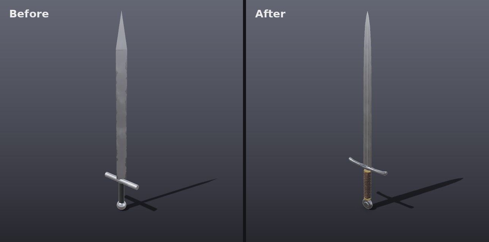
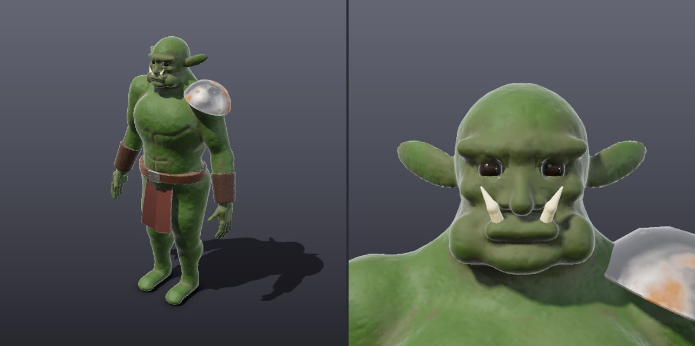
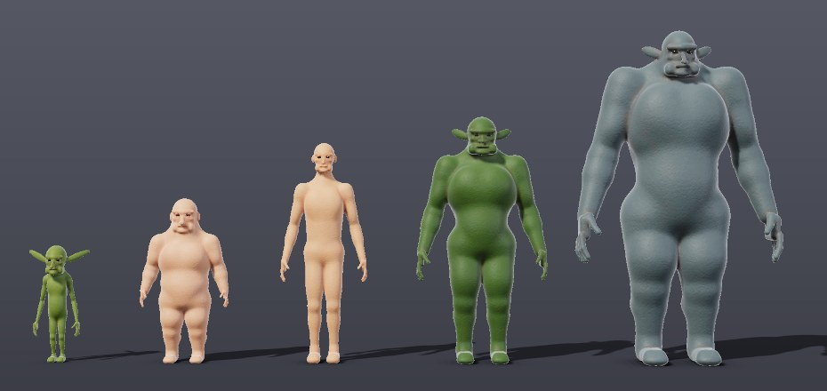
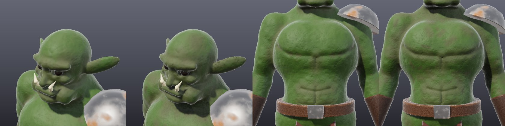
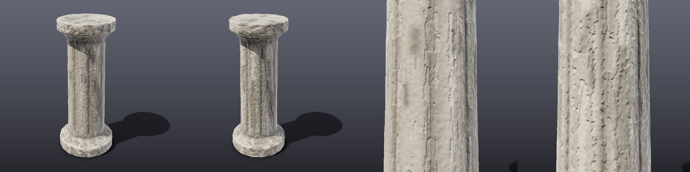
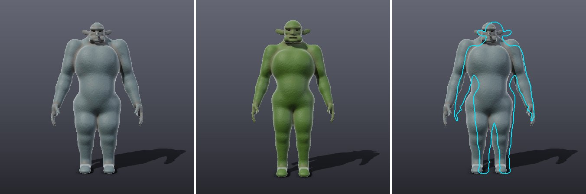

# Modelling recipes

Worked examples of how to build convincing game props with MeshMind's tools.
Each one is a real script, [`scripts/recipes.py`](../scripts/recipes.py), that
drives `meshmind-mcp` with ordinary tool calls, so an agent can follow the
same steps. Run them yourself:

```sh
cargo build --release -p meshmind-mcp
python3 scripts/recipes.py out            # all of them
python3 scripts/recipes.py out sword      # just one
```

## The rule that matters most

**Pick the shape tool by the part's silhouette.** Boxes and plain cylinders
read as placeholders. Almost every real object is made of parts that are
lofted, lathed, extruded from an outline or swept along a path:

| Part looks like | Tool | Examples |
|---|---|---|
| Changes cross-section along its length | `loft` | blades, handles, horns, legs, spires, fins |
| Round, like it was turned on a lathe | `lathe` | pommels, knobs, bottles, barrels, wheels, columns |
| A flat silhouette with thickness | `extrude_outline` | axe heads, shields, brackets, gears, signs |
| A tube along a path | `sweep` | rope, cables, pipes, rings, grip wraps (`helix`) |
| Curved, twisted or tapered | `deform` | curved blades, twisted bars, bent handles |

Then: small separate parts (rings, ferrules, straps, rivets) for realism,
`bevel` on hard edges, `apply_smart_material` last, and `render_preview` with
`focus` to inspect small parts up close.

## Longsword



The **before** sword is what you get from primitives: a 4-sided cylinder
squashed into a blade, a cone tip, a cylinder guard and grip, a sphere
pommel. Every part is the right size, and none of it reads as a sword. The
**after** sword is 24 tool calls:

1. **Blade, `loft`.** The cross-section is a lens with a shallow groove in
   each face (the fuller). It is about 2 units wide and 1 thick, and each
   station scales it: 5.4 cm wide at the guard, narrowing gently, then
   curving in to `scale: [0, 0]` for the point. Sharp edges on the outline
   stay crisp; the curved faces are shaded smooth automatically.
2. **Crossguard, `loft` then `set_transform`.** An octagon lofted from one
   tip to the other: thick in the middle, slimmer arms, flared ends. Each
   end station has an `offset` so the ends sweep up towards the blade. It is
   built along Y and turned 90° to lie flat.
3. **Grip, `lathe` + `sweep`.** A slightly barrel-shaped core, wrapped by a
   leather cord: `sweep` with `helix: {radius: 0.0155, height: 0.15,
   turns: 22}` and a 3.6 mm tube.
4. **Ferrules, `lathe`.** Two thin rings at either end of the grip, in `gold`.
   Small trim parts like these do a lot for realism.
5. **Pommel, `lathe` turned on its side.** A wheel with a raised central
   boss, rotated 90° about X so it faces forward.
6. **Materials.** `polished_metal` on the blade (mirror-like, brushed along
   its length, light scratches), `polished_metal` with more wear on the guard
   and pommel, `gold` on the ferrules, `leather` on the grip.


The close-up is `render_preview` with `focus` set to the hilt's object ids.

## Axe, barrel, potion bottle


- **Axe:** an oval handle lofted with a swelling near the head and the
  butt, then `deform` with `mode: bend` for a slight curve. The head is
  `extrude_outline` of the bearded silhouette, bevelled, in worn
  `polished_metal`. A leather wrap at the bottom is a short helix `sweep`.
- **Barrel:** one `lathe` with a bulging profile, in `wood`, and four
  thin lathed bands in `rusty_metal`, each sized to sit on the bulge.
- **Potion bottle:** a lathed body (round belly, narrow neck, lip) in
  tinted `glass`, a lathed cork in `wood`, and a cord round
  the neck made by sweeping a closed circle (`path` whose last point equals
  the first).

## Characters: the orc warrior



Characters need a different approach from props. A body built from separate
spheres, cylinders and boxes always looks like a stack of toys, however many
parts it has. MeshMind builds bodies the way a sculptor blocks out clay:
overlapping volumes melted into **one smooth, watertight surface**.

```sh
python3 scripts/recipes.py out orc
```

1. **`create_character`** with `species: "orc"` gives a 2 m body with orc
   proportions (broad chest, narrow waist, hunch, heavy jaw, pointed ears),
   five-fingered hands, eyelids and eyeballs. It also returns *landmarks*:
   world points such as `left_lower_canine`, `waist_front`, `waist_left`,
   `left_shoulder_top` and `left_forearm_outer` that gear is sized from.
2. **`sculpt_body` with `edit_parts`** changes parts by name (here heavier
   forearms and a fuller lower lip) and rebuilds the surface.
3. **`sculpt`** adds the character: `crease` for frown lines, the folds from
   nose to mouth, the line under the chest muscles and the abdominal bands;
   `inflate` for cheekbones and a forearm vein; `noise` over everything for
   lumpy hide. Strokes mirror to the other side and snap onto the skin.
4. **Tusks** are a small `sculpt_body` of two mirrored capsules that taper
   to a point, starting at the lower canines, in `bone`.
5. **Gear** is separate props sized from the landmarks: a lofted leather belt
   that fits the waist, a buckle and a fabric loincloth from
   `extrude_outline`, lathed leather bracers turned to follow the forearms,
   and a lathed iron pauldron on the shoulder.
6. The body gets the **`skin`** smart material (mottled, warmer in creases,
   pores in the normal map).

`create_character` also covers humans (optionally `feminine`), goblins,
dwarves and trolls, with options for height, bulk, gut, hunch, jaw, ears,
head size, limb lengths and an A-pose for rigging:



For creatures that aren't humanoid (beasts, slimes, tentacles, rocks, roots)
use `sculpt_body` directly with your own list of ellipsoids, tapered
capsules and rounded boxes.

## Game-ready: baking the detail down

Sculpting needs a dense mesh, but a game can't afford one: the orc body is
about 180,000 triangles. **`make_game_ready`** does what an artist does in a
baking tool, in one call:

1. Reduces the mesh to a triangle budget, keeping the silhouette and UV seams.
2. Unwraps it and bakes the dense mesh's detail into a **normal map** (folds,
   creases, pores) and an **ambient occlusion** map (soft shadow in crevices).
3. Re-applies the object's smart material on top of the baked maps.
4. Builds **LODs** (by default at half and a quarter of the budget), which
   export as `_LOD0`, `_LOD1` and `_LOD2` under one node in the glTF.

```sh
python3 scripts/recipes.py out pillar
```

Orc body, 178,852 triangles before and 20,000 after (full view and chest
close-up, before then after):



A sculpted stone pillar, about 70,000 triangles before and 3,000 after:



Budgets the agent is given: hero character 15,000 to 40,000 triangles, enemy
5,000 to 15,000, weapon 1,500 to 5,000, small prop 300 to 1,500. `decimate`
(reduce only) and `bake_detail` (bake from another object, such as a
high-poly copy) are there for finer control. Undo brings the dense mesh back.

## Matching concept art

Give the agent a reference image and it can measure itself against it.
`set_reference` loads a PNG or JPEG for a view (front, back, left, right or
three_quarter). `compare_to_reference` renders the model from that view and
returns three panels: the reference, the model, and the model's outline in
cyan over the reference, scaled to the same height. It also lists where the
model is too wide or too narrow, band by band from top to bottom:



Here the reference is a troll and the model an orc, so the outline sits
inside the troll's bulk and the tool reports the arms and legs as too narrow.
A plain background works best, because the subject is separated from it by
colour.

## Known gaps

- Character bodies have no rig yet.
- Hands are open and relaxed; a fist gripping a weapon still has to be
  adjusted with `edit_parts`.
- Fullers run the whole length of a lofted blade; a fuller that stops short
  of the point needs a `boolean` cut instead.
